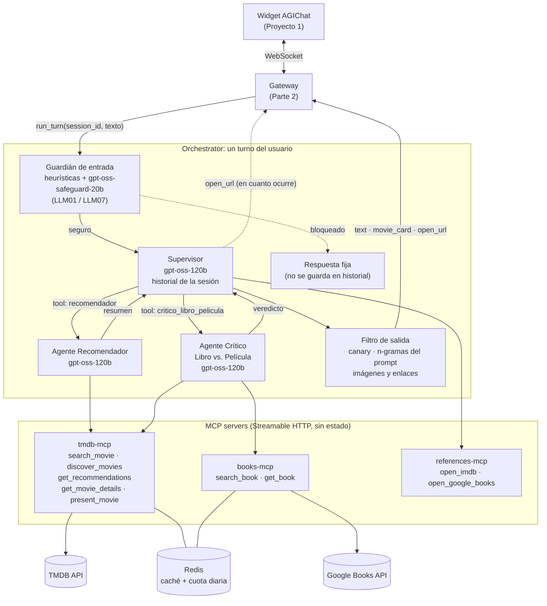
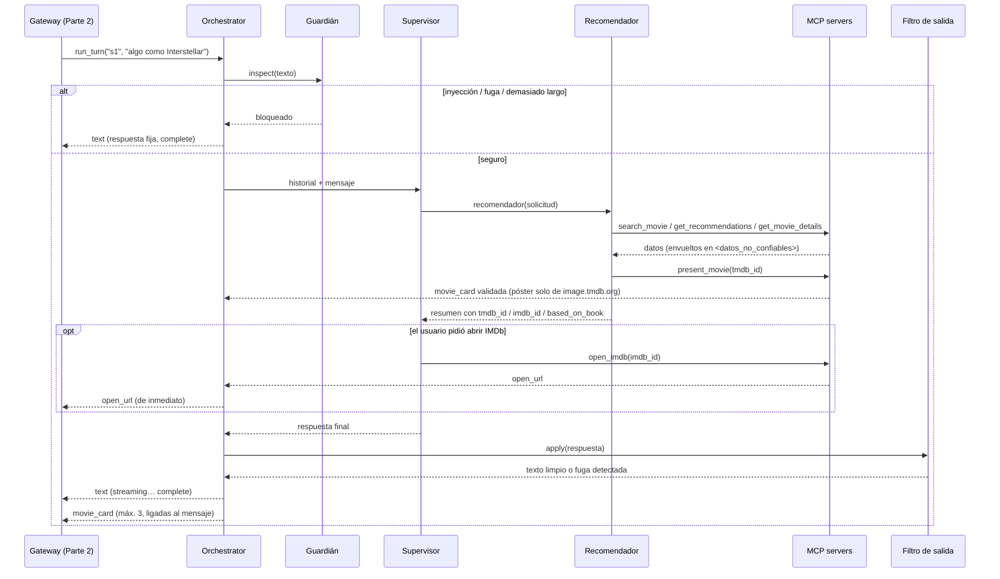

# Arquitectura de bajo nivel: organización de los agentes

## Clasificación

El sistema es **jerárquico y centralizado**, con un **pipeline de seguridad en serie** alrededor
del supervisor:

- **Jerárquico (2 niveles):** el _Supervisor_ es el único agente que habla con el usuario y el
  único que decide a quién delegar. Los especialistas (_Recomendador_ y _Crítico Libro vs.
  Película_) son herramientas del supervisor: reciben una solicitud, la resuelven con sus tools y
  le devuelven un resumen. No se comunican entre ellos ni con el usuario.
- **Centralizado:** en cada turno hay un solo coordinador que tiene el historial de la
  conversación. Los especialistas no guardan estado: cada llamada empieza de cero con solo la
  solicitud del supervisor.
- **Pipeline en serie:** _Guardián de entrada → Supervisor → Filtro de salida_. Ningún mensaje
  llega al supervisor sin pasar por el guardián, y ninguna respuesta llega al usuario sin pasar
  por el filtro.

### Por qué esta organización y no una descentralizada

| Criterio                                                 | Decisión                                                                                                                                                                 |
| -------------------------------------------------------- | ------------------------------------------------------------------------------------------------------------------------------------------------------------------------ |
| Pocos dominios bien separados (cine, libros, navegación) | Un supervisor que enruta basta; una red de pares agregaría rondas de mensajes sin aportar nada.                                                                          |
| Seguridad (LLM01/LLM07)                                  | Un solo punto de entrada y de salida donde poner el guardián y el filtro. En una red descentralizada habría que proteger cada arista.                                    |
| Voz consistente para el producto de Maxine               | Solo el supervisor redacta lo que lee el usuario.                                                                                                                        |
| Costo y cuotas del free tier                             | Tope global de llamadas a tools por turno (`TurnContext.max_tool_calls = 12`) compartido por todos los agentes; es fácil de imponer porque todo pasa por el mismo turno. |
| Contexto del LLM                                         | Cada especialista ve solo su tarea y sus tools, con prompts cortos y menos tokens.                                                                                       |

**Costo de la decisión:** el supervisor agrega un salto de LLM y es un cuello de botella lógico
por turno. Se mitiga porque el `Orchestrator` no guarda estado (el historial vive en el
`SessionStore`): se levantan tantas réplicas como haga falta detrás del gateway.

## Diagrama de organización

## Permisos de cada agente (mínimo privilegio)

Cada agente recibe **solo** las tools que nombra en `factory.py` (`McpToolbox.select`); si el
modelo intenta llamar otra, recibe un error y no se ejecuta nada.

| Agente       | Tools                                                                                          | Puede abrir pestañas                  | Ve el historial             |
| ------------ | ---------------------------------------------------------------------------------------------- | ------------------------------------- | --------------------------- |
| Supervisor   | `recomendador`, `critico_libro_pelicula`, `open_imdb`, `open_google_books`                     | Sí (solo IMDb y Google Books, por id) | Sí (últimos 12 mensajes)    |
| Recomendador | `search_movie`, `discover_movies`, `get_recommendations`, `get_movie_details`, `present_movie` | No                                    | No                          |
| Crítico      | `search_movie`, `get_movie_details`, `search_book`, `get_book`                                 | No                                    | No                          |
| Guardián     | ninguna                                                                                        | No                                    | No (solo el mensaje actual) |

Todas las tools son de **solo lectura**: no hay ninguna que escriba, borre ni mande datos a
terceros.

## Secuencia de un turno

## Defensas contra el OWASP Top 10 for LLMs

| Riesgo                                              | Control                                                                                                                                                                                      | Dónde                                                  | Test                                             |
| --------------------------------------------------- | -------------------------------------------------------------------------------------------------------------------------------------------------------------------------------------------- | ------------------------------------------------------ | ------------------------------------------------ |
| LLM01 directa                                       | Heurísticas sobre texto normalizado (sin tildes, leetspeak, base64 decodificado) + clasificador `gpt-oss-safeguard-20b`                                                                      | `agents/guardian.py`                                   | `tests/agents/test_guardian.py`                  |
| LLM01 indirecta (sinopsis o descripción envenenada) | Salidas de tools dentro de `<datos_no_confiables>` con cierre neutralizado; regla en todos los prompts                                                                                       | `agents/untrusted.py`, `agents/prompts.py`             | `test_tools_y_agente.py`                         |
| LLM01: abrir sitios maliciosos                      | `references-mcp` solo acepta ids con regex (`^tt\d{7,10}$`) y arma la URL; `OpenUrlEvent` revalida https + dominio del sitio                                                                 | `mcp_servers/references/server.py`, `agents/events.py` | `test_books_y_references.py`, `test_events.py`   |
| LLM01: exfiltración por imagen o enlace             | El póster va en `movie_card` (CDN de TMDB validado), no en Markdown; el filtro quita `` y enlaces fuera de la lista blanca                                                              | `agents/output_filter.py`                              | `test_output_filter.py`                          |
| LLM01: abuso de tools                               | Mínimo privilegio por agente, schemas estrictos (longitudes, rangos, patrones), tope de 12 tools por turno, pasos máximos por agente                                                         | `factory.py`, `agents/agent.py`                        | `test_tools_y_agente.py`, `test_orchestrator.py` |
| LLM07 (fuga del system prompt)                      | El prompt no contiene secretos (las API keys viven solo en los MCP servers); regla explícita de no revelar y frase fija; canary token por proceso; bloqueo por n-gramas literales del prompt | `agents/prompts.py`, `agents/output_filter.py`         | `test_output_filter.py`, `test_orchestrator.py`  |
| Persistencia del ataque                             | Los mensajes bloqueados no entran al historial; el historial guarda solo texto final (no salidas de tools)                                                                                   | `agents/orchestrator.py`                               | `test_orchestrator.py`                           |

### Por qué la respuesta no se transmite token a token desde el LLM

El filtro de salida necesita el texto **completo** para detectar el canary o un fragmento del
prompt. Si se mandaran los tokens conforme salen, el usuario ya habría visto la fuga cuando el
filtro la detecte. Groq genera a cientos de tokens por segundo, así que la espera es corta; el
`Orchestrator` igual manda el texto en varios eventos `streaming` para que el widget conserve su
animación.
